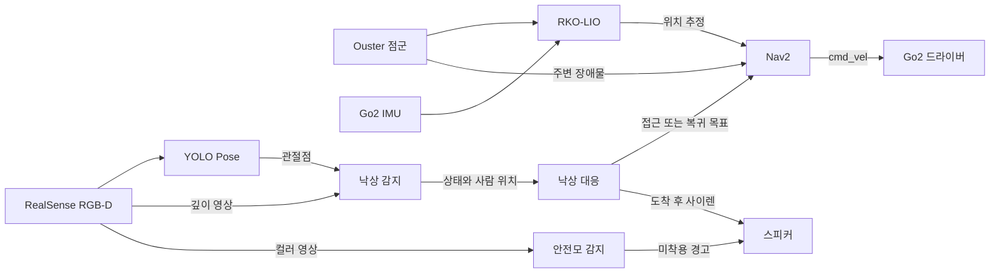

# Unitree Go2 안전 순찰 워크스페이스

Unitree Go2가 현장 지도를 따라 주행하면서 작업자의 낙상과 안전모 미착용을 감지하는 ROS 2 Humble 프로젝트입니다. Ouster LiDAR와 Go2 IMU로 로봇의 위치를 추정하고, RealSense의 컬러·깊이 영상으로 사람의 자세를 판별합니다. 낙상이 확인되면 위치와 이벤트를 발행하며, 자동 대응을 켠 경우 순찰 목표를 잠시 바꾸고 사이렌을 울릴 수 있습니다.

**기본 실행 범위:** 통합 Nav2 launch는 Go2, Ouster, RealSense, RKO-LIO, Nav2와 낙상 **대응** 노드를 시작합니다. 사람을 찾는 YOLO, 낙상·안전모 **감지** 노드, 스피커, 웹 관제는 각각 필요한 경우에 실행합니다. 낙상 감지만 켜서 영상을 점검할 수 있고, 로봇의 자동 접근은 기본적으로 꺼져 있습니다.

## 개발팀과 역할

두 명의 팀원이 주행 시스템과 비전 시스템을 각각 구성하고, 두 시스템을 연결해 Go2 안전 순찰 캡스톤 프로젝트를 함께 완성했습니다.

| 담당 | 구성한 시스템 |
| --- | --- |
| 주행·로봇 통합 담당 · [yeah_go2](src/yeah_go2) | Go2와 Ouster LiDAR·IMU 연동, RKO-LIO 위치 추정, Nav2 경유점 주행, 낙상 이벤트에 따른 주행 전환 |
| 비전·안전 감지 담당 · [yeah_vision](src/yeah_vision) | RealSense와 YOLO 연동, 작업자 낙상·안전모 미착용 판정, 이벤트 이미지와 음성 경고, 웹 관제용 데이터 연동 |

## 패키지 구조

| 패키지 | 역할 |
| --- | --- |
| [yeah_bringup](src/yeah_go2/yeah_bringup) | 전체 실행 진입점. 센서 좌표계 연결, IMU 메시지 변환, Nav2 설정, 경유점 관리, 낙상 시 주행 전환을 담당합니다. |
| [go2_driver](src/yeah_go2/go2_driver) · [go2_bringup](src/yeah_go2/go2_bringup) | Go2의 상태를 읽고 `/cmd_vel`을 Unitree 이동 명령으로 변환합니다. `unitree_go`, `unitree_api`, `go2_interfaces`가 메시지와 서비스 타입을 제공합니다. |
| [ouster-ros](src/yeah_go2/ouster-ros) · [rko_lio](src/yeah_go2/rko_lio) | LiDAR 점군과 IMU를 결합해 위치·자세를 추정합니다. `glim`, `glim_ros2`, HDL Localization 소스도 함께 관리하며, 아래 주행 예시는 RKO-LIO를 사용합니다. |
| [realsense-ros](src/yeah_vision/realsense-ros) · [yolo_ros](src/yeah_vision/yolo_ros) | 컬러·정렬 깊이 영상과 사람의 관절점 검출을 제공합니다. 두 저장소는 서브모듈로 버전을 고정합니다. |
| [my_safety_pkg](src/yeah_vision/my_safety_pkg) | 낙상 상태·사람 위치 추정, 안전모 판정, 경고음 재생, 웹 관제용 위치 전송을 담당합니다. |



## 설치와 로컬 자료

ROS 2 Humble과 `colcon`을 사용합니다. 주행에는 Unitree DDS 통신 환경, Ouster 드라이버, RealSense SDK, Nav2의 MPPI 컨트롤러와 Spatio-Temporal Voxel Layer가 필요합니다. RKO-LIO의 네이티브 의존성은 [CMake 설정](src/yeah_go2/rko_lio/CMakeLists.txt)에서 확인할 수 있습니다. 비전 노드는 `cv_bridge`, OpenCV, Ultralytics와 추론 환경이 필요하며, 안전모 노드의 기본 장치는 `cuda:0`입니다.

```bash
git clone --recurse-submodules https://github.com/taehyun0128/capstone_ws.git yeah_ws
cd yeah_ws
# 이미 복제한 저장소에서도 두 의존성을 받을 수 있습니다.
git submodule update --init --recursive
mkdir -p local
```

| 로컬에서 준비할 자료 | 사용하는 곳 |
| --- | --- |
| 같은 현장을 담고 좌표가 정렬된 3D 지도 `local/map.ply`, 2D 지도 `local/map.yaml` 및 YAML의 `image`가 가리키는 파일 | RKO-LIO는 PLY, Nav2 map server는 YAML과 이미지를 읽습니다. |
| 현장 경유점 파일 | [waypoints.example.yaml](src/yeah_go2/yeah_bringup/config/waypoints.example.yaml)은 형식 확인용 가상 좌표입니다. 실제 순찰 좌표는 `local/` 아래에 둡니다. |
| 사람 자세 모델 `local/yolov8n-pose.pt`, 안전모 모델 `local/best.pt` | 낙상용 관절점 검출과 안전모 검출에 서로 다른 모델을 사용합니다. |
| `helmet.mp3`, `siren.mp3` | 경고음을 사용할 때 `src/yeah_vision/my_safety_pkg/audio/`를 만들고 **빌드 전에** 파일을 넣습니다. MP3 재생에는 `mpg123`이 필요합니다. |

로봇 SDK와 ROS·비전 의존성을 준비한 장치에서 빌드합니다. 아래 명령은 워크스페이스 루트 기준입니다.

```bash
source /opt/ros/humble/setup.bash
colcon build
source install/setup.bash
ros2 pkg executables my_safety_pkg
```

새 터미널에서도 워크스페이스 루트로 이동해 두 `setup.bash`를 순서대로 불러오세요. 마지막 명령에 `fall_detection_node`, `helmet_detection_node`, `speaker_warning_node`, `odom_ws_bridge`가 표시되면 안전 패키지의 실행 파일이 등록된 상태입니다.

## 주행과 초기 위치

1. Go2·LiDAR와 통신할 네트워크 인터페이스 및 ROS 도메인을 맞추고, 셸 변수 `OUSTER_HOST`에 실제 센서 호스트명 또는 주소를 설정합니다.
2. 아래 명령으로 주행 스택을 실행합니다. `use_nav2_rviz:=true`는 초기 위치와 목표를 지정할 RViz 창을 엽니다.
3. RViz의 **2D Pose Estimate**로 실제 로봇의 위치와 방향을 지도 위에 지정합니다. RKO-LIO의 지도 위치 추정은 `/initialpose`를 기다립니다. 위치가 맞고 Nav2가 활성화된 것을 확인한 뒤 목표를 지정합니다.

```bash
ros2 launch yeah_bringup go2_ouster_rko_lio_nav2.launch.py \
  go2_sensor_hostname:="${OUSTER_HOST:?Set OUSTER_HOST first}" \
  rko_global_map_path:="$PWD/local/map.ply" \
  map_yaml:="$PWD/local/map.yaml" use_nav2_rviz:=true
```

LiDAR의 UDP 수신 주소를 직접 지정해야 하면 `go2_udp_dest`를 추가합니다. Nav2 시작 지연의 기본값은 30초이며 초기 위치 입력은 별도로 필요합니다. 실내 전용 [launch](src/yeah_go2/yeah_bringup/launch/go2_ouster_rko_lio_nav2_indoor.launch.py)는 같은 스택에 `indoor_rko_global_map_path`와 `indoor_map_yaml`을 전달합니다. 주행 속도·장애물 레이어·플래너는 [nav2_go2.yaml](src/yeah_go2/yeah_bringup/config/nav2_go2.yaml), 위치 추정은 [rko_lio_go2.yaml](src/yeah_go2/yeah_bringup/config/rko_lio_go2.yaml)에서 확인하세요.

**경유점 순찰**은 별도 노드입니다. 현장 경로를 넣은 YAML과 그 파일의 `routes` 아래 키 이름을 지정합니다. 아래 예시는 `example` 키를 사용하며, 노드의 `auto_start` 기본값은 `False`입니다.

```bash
ros2 run yeah_bringup waypoint_event_manager.py --ros-args \
  -p waypoints_file:="$PWD/local/waypoints.yaml" -p route_name:=example
```

다른 터미널에서 `ros2 service call /waypoint_event/list std_srvs/srv/Trigger '{}'`로 경로를 확인할 수 있습니다. `/waypoint_event/start` 서비스를 호출하면 첫 목표가 발행됩니다.

## 낙상·안전모 감지

아래 예시는 주행 launch로 RealSense가 실행 중인 상태를 기준으로 합니다. 장시간 실행되는 명령은 각각 별도 터미널에서 실행합니다.

**낙상 감지.** YOLO Pose가 `/yolo/detections`에 사람 관절점을 발행합니다. 낙상 노드는 이 결과와 정렬된 깊이 영상, 카메라 내부 파라미터를 받아 몸통 기울기와 자세가 유지된 시간을 판단합니다. 아래 구성에서는 낙상 노드가 자체적으로 3D 위치를 계산하므로 YOLO의 3D 박스 노드는 생략합니다.

```bash
ros2 launch yolo_bringup yolo.launch.py model:="$PWD/local/yolov8n-pose.pt" \
  input_image_topic:=/camera/camera/color/image_raw \
  use_tracking:=False use_3d:=False device:=cuda:0
```

```bash
ros2 run my_safety_pkg fall_detection_node
```

이상 자세가 기본 1초간 지속되면 `NORMAL → DETECTING → DANGEROUS`로 진행합니다. 유효한 깊이 관측이 모이면 `/fall_detection/fallen_person_pose`가 발행됩니다. **위험 상태와 유효한 접근 좌표는 따로 확인**해야 합니다. 자동 접근은 `/fall_detection/set_goal_publishing`(`std_srvs/srv/SetBool`)으로 제어합니다. 활성화하면 의심 단계에서 주행을 일시 중지하고, 확정 시 사람으로부터 약 1 m 떨어진 지점에 접근 목표를 만듭니다. 도착 후 `/siren_control`을 켜며, 사이렌 해제 신호를 받으면 저장된 기존 목표로 복귀합니다. 아래의 알려진 제약도 확인하세요.

**안전모 감지와 음성 경고.** 안전모 노드는 컬러 영상에 별도 모델을 적용합니다. 미착용이 새로 감지되면 이벤트 이미지와 `/safety/event`, `/helmet_warning`을 발행합니다. 음성 출력을 사용할 때 두 번째 명령을 별도 터미널에서 실행합니다.

```bash
ros2 run my_safety_pkg helmet_detection_node --ros-args -p model_path:="$PWD/local/best.pt"
```

```bash
ros2 launch my_safety_pkg speaker_warning.launch.py
```

## 웹 관제

로봇 위치만 필요한 클라이언트는 `ros2 run my_safety_pkg odom_ws_bridge`로 연결할 수 있습니다. 기본 WebSocket 포트는 `8765`이며, `/rko_lio/odometry`를 받아 `frame_id`, `x`, `y`, `z`, `theta`(라디안), `theta_deg`를 포함한 JSON을 보냅니다.

전체 관제 구성은 `ros2 launch my_safety_pkg safety_web_stack.launch.py`로 시작합니다. 이 launch는 위치 브리지도 함께 시작하므로 둘 중 하나만 실행하세요. 전체 구성은 별도 FastAPI 앱(`~/safety_web_server/main.py`의 `app`), `uvicorn`, `rosbridge_server`, `web_video_server`, Python `websockets`와 이미지 디렉터리 `~/safety_event_images`를 전제로 합니다. FastAPI 포트는 `8000`, 이벤트 이미지 서버는 `8090`입니다. 다른 PC에서 사진을 열려면 두 감지 노드의 `event_image_base_url`을 해당 PC에서 접근 가능한 이미지 서버 URL로 지정하세요. 기본값은 `http://localhost:8090`입니다.

## 동작 점검과 알려진 제약

| 증상 | 먼저 확인할 항목 |
| --- | --- |
| 지도가 보이지만 로봇 위치가 갱신되지 않음 | `ros2 topic hz /ouster/points`, `ros2 topic hz /go2/imu`로 입력을 확인합니다. 초기 위치 입력 후 `ros2 topic hz /rko_lio/odometry`와 `ros2 run tf2_ros tf2_echo map base_link`로 위치 추정을 확인합니다. |
| 이동 중 Nav2의 속도 정보가 갱신되지 않음 | `bt_navigator`의 기본 입력은 `/odom`입니다. 현재 Go2 드라이버는 이 토픽을 최초 한 번 발행하고, RKO-LIO의 연속 출력은 `/rko_lio/odometry`로 전달됩니다. 두 토픽의 발행 주기와 실제 구독자를 비교하세요. |
| 카메라는 켜졌는데 낙상 이벤트가 없음 | `ros2 topic hz /yolo/detections`와 `ros2 topic echo /fall_detection/status`를 확인합니다. 상태만 나오면 정렬 깊이 영상, 카메라 정보, `/fall_detection/fallen_person_pose`를 차례로 확인하세요. |
| 낙상 대응에서 이전 위치를 사용하거나 주행에 복귀하지 못함 | 현재 [대응 노드](src/yeah_go2/yeah_bringup/scripts/fall_detection_unified_node.py)는 이벤트 초기화 후 이전 사람 좌표를 보관합니다. 좌표나 TF를 얻지 못한 채 5초가 지나면 목표 발행 없이 재시도가 끝나고 이후 `NORMAL`에도 자동 복귀가 막힐 수 있습니다. 반복 이벤트를 시험할 때 좌표 시각과 주행 상태를 함께 기록하세요. |
| 모델 또는 경고음을 찾지 못함 | `model_path`가 실제 가중치 파일을 가리키는지, 음원을 추가한 뒤 패키지를 다시 빌드했는지 확인합니다. |

**검증 범위:** 공개 파일로 기존 ROS 의존성 환경에서 `yeah_bringup`과 `my_safety_pkg` 빌드를 확인했습니다. 위 두 낙상 상태 문제는 모의 콜백으로 확인했으며, 전체 워크스페이스의 신규 장치 설치, 실기기 주행과 감지 정확도는 별도 검증 대상입니다.
